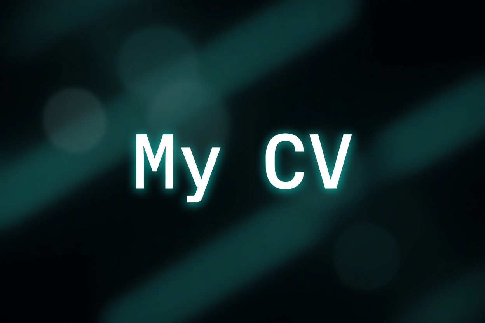

# MyCV



Personal portfolio and CV of Samer Kolasević: a fast, static, bilingual (EN / BS) site built with plain HTML, CSS and JavaScript. No frameworks, no build step.

Live at **https://samer.kolasevic.com**

## File structure

```
├── assets                  # All static content
│   ├── Articles            # Article and presentation PDFs
│   ├── Documents           # Downloadable documents (Europass CV)
│   ├── Icons               # Favicon, section and social icons
│   └── MainMaterial        # Project screenshots, videos and photos
├── CNAME                   # Custom domain record
├── index.html              # Page markup and all content (EN/BS via data attributes)
├── robots.txt              # Crawler rules
├── script.js               # Language switcher, sliders, navbar, PDF viewer
├── sitemap.xml             # Sitemap for search engines
└── style.css               # All styling, responsive layout
```

## Hosting pipeline

Self-hosted on a homelab: Ubuntu Server running Nginx, exposed to the internet through a Cloudflare Tunnel at `samer.kolasevic.com`.

## Coming next

- Refactor the Articles section for easier posting: drop in a Markdown file in English and one in Bosnian, and the page picks up the title and header (front matter) on its own and builds the article list automatically
- Better mobile layout
