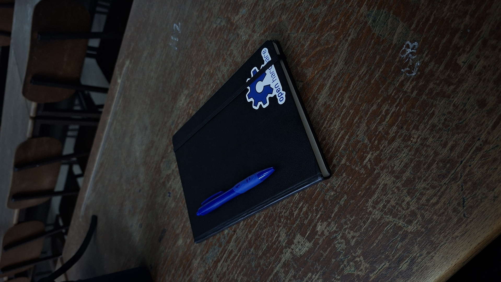
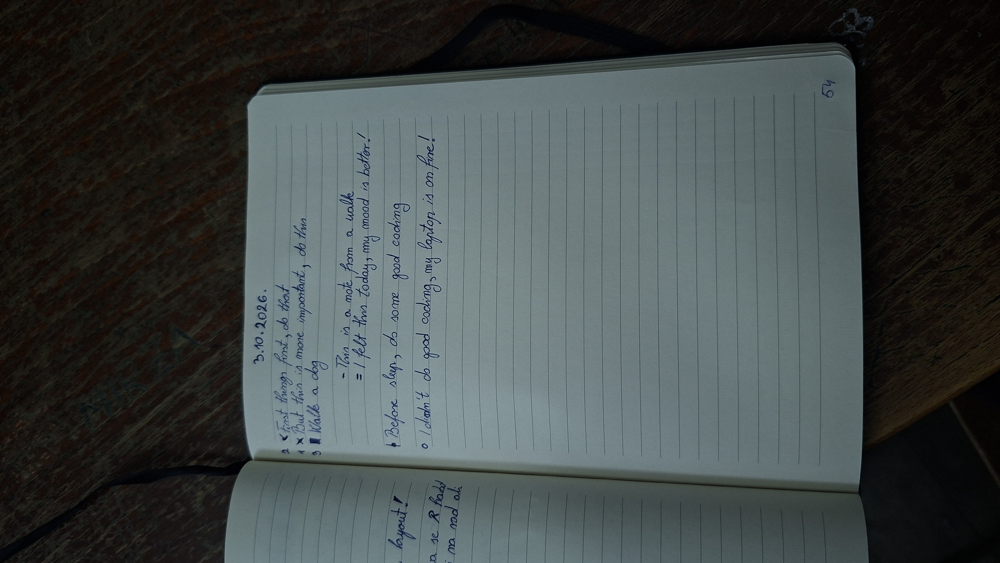

# Kako je rokovnik napravio meni produktivniju svakodnevnicu

Tokom procesa sklanjanja distrakcija i nesvjesnog brainrota, trebalo mi je nešto što će me držati i konstantno podsjećati na načela koja stičem. Motivaciju, a i daljnju disciplinu, pridonio mi je kanal po imenu **Bullet Journal** ([inicijalni video](https://youtu.be/fm15cmYU0IM)), koji objašnjava format i pristup jednom rokovniku koji će stvarno imati efekta.

Fokus je na tome da, ma koliko To-do ili Calendar aplikacija napravili, one jednostavno nemaju na svaku osobu pozitivan rezultat. Prave veliku neposjećenost i/ili stres kada se nagomila To-do stvari. Imao sam iskustva sa Notionom, kojeg sam jednom podesio i nikada više nisam ušao...

Činjenice koje potkrepljuju pisanje ciljeva i to-do stavki na papiru:

1. **Efekt generisanja (Generation Effect):** psihološka istraživanja pokazuju da se ideje i zadaci koje sami generišemo i ispišemo rukom skladište dublje u dugoročnoj memoriji. Pamtiš zadatke s liste čak i ako tu listu kasnije ne pogledaš.
2. **Manje ometanja:** papir ne šalje obavijesti, ne nudi dodatne tabove i ne dijeli fokus, što omogućava dublji nivo organizacije misli.
3. **Kinestetička memorija:** ljudi koji koriste papir imaju bolju prostornu orijentaciju u vlastitim obavezama. Mozak pamti gdje se zadatak nalazio na stranici (npr. gornji lijevi ugao, pored crteža), što olakšava mentalno mapiranje dana. Fizičko precrtavanje ili popunjavanje BuJo simbola (• u X) stvara jači taktilni završetak zadatka i oslobađa dopamin na intenzivniji način nego klik na digitalni kružić.

I još mnoge druge, kao što su veći procenat ostvarivosti cilja, akcije, želje.

## Efekat nakon mjesec dana

Rezultat Bullet journalinga je otišao u savršenom smjeru, čak štaviše, ne bih mogao ni zaspati a da sebi ne stavim sutrašnji dan na papir. Neke stvari koje sam uvidio na sebi:

- **Stres na minimumu:** bio sam poznat kao osoba koja je smrknuta na prvu, sve je dotiče, "kratkog fitilja" i sve što je bilo usko vezano za povišen kortizol. Sada sam postao daleko tolerantniji u svakodnevnici i poželjniji kod drugih ljudi.
- **Fokusiraniji:** od osobe koja nije mogla mirno sjediti u sesiji rada, sada se zadubim da ne znam ni koliko je sati.
- **Disciplinovaniji:** prije rokovnika sam davao sebi izgovore za trening i rad kod kuće. Malo poslije, svaki trening je bolji od prošlog jer i njih isto zapisujem, a imam i redovan san jer mi se razvila obzirnost prema značaju sna.
- **"Combo efekat":** habit tracker (instrukcije o journalingu su u sekciji nakon ove), pored rezultata, daje mi satisfakciju kada vidim da su npr. trening, čitanje knjige i rad već 5. dan za redom ispoštovani.
- **Raspoređen dan od jutra do mraka:** nema sata u danu a da nije zauzet (naravno, ima tu oduška sebi). Treba krenuti prvih dana lagano, a kada vidimo da možemo sve moguće, onda samo redati više stvari. One koje se poslije podrazumijevaju (ustajanje u xx:xx sati, trening u xx:xx sati) prestanu se pisati i onda se pišu neke druge stvari, da ne bismo lagali sebe u količini akcija u danu.

## Format rokovnika

**Preduslov za početak:** penkalo i rokovnik ili neka bilježnica.

### 1. Namjere (Intentions)

- 1 do 5 namjera koje želite ispuniti tokom ovog procesa

**Format:** Želim da budem (nešto ili šta) da bih (razlog ili način)

### 2. Sadržaj (Index)

**Preduslov:** numerisati stranice tokom procesa.

- Ime poglavlja i pored njega raspon od koje do koje stranice je to poglavlje

**Primjer:** Acts (oktobar) 13-43, 45-47, 49

**Napomena:** ako se poglavlja budu preklapala, što je sasvim prirodno, samo početi ponovo praviti raspone ili nabrajati stranice.

### 3. Future log

**Format:** davati mjesecima po par redova i tu pisati nešto što će se eventualno desiti (događaji, obaveze...).

**Pravilo:** nikada ne pisati u mjesec u koji smo već ušli (npr. u oktobru pišemo samo za novembar, decembar...).

### 4. Month log + habit tracker

Stranica kojoj svakom redu pripada jedan dan (dan u sedmici i dan u mjesecu), a vertikalno su poredane do 3 navike koje možeš uraditi taj dan.

| Dan | Događaj | Habit 1 | Habit 2 | Habit 3 |
|-----|---------|:-------:|:-------:|:-------:|
| 12 sri | rođendan | x | x | x |
| 13 čet | | x | x | |
| ... | | | | |
| 31 | | x | | |

Ovo je sekcija koja se dnevno posjećuje, a habit tracker treba da daje satisfakciju "Combo efekta".

### 5. Dnevne akcije (Acts)

Datum dana koji se zapisuje.

**Napomena:** najbolja praksa je noć prije tog dana zapisati šta se sve radi.

- Mjesto na kojem se zapisuju podsjetnici, zanimljive stvari, akti, osjećanja itd.

**Legenda oznaka:**

| Simbol | Upotreba |
|:------:|----------|
| • | Akcija (tek napisana) |
| x | Akcija (urađena) |
| \| | Akcija (neurađena) |
| ▮ | Akcija (nemoguća za uraditi) |
| &lt; | Akcija (prolongirana) |
| - | Podsjetnik, zabilješka |
| = | Osjećanje, utisak |
| ○ | Interrupt (nešto što nas je omelo) |
| * | Nešto važno (dodatak na svaki ovaj simbol) |

**Best practice:** nakon raspisivanja akcija, odmah numerisati top 3 radi boljeg efekta.

**Napomena:** ovo nije to-do nego akcija, potez. Razlog je taj što To-do psihološki stvara stres i loš pristup stvarima koje trebamo uraditi.

