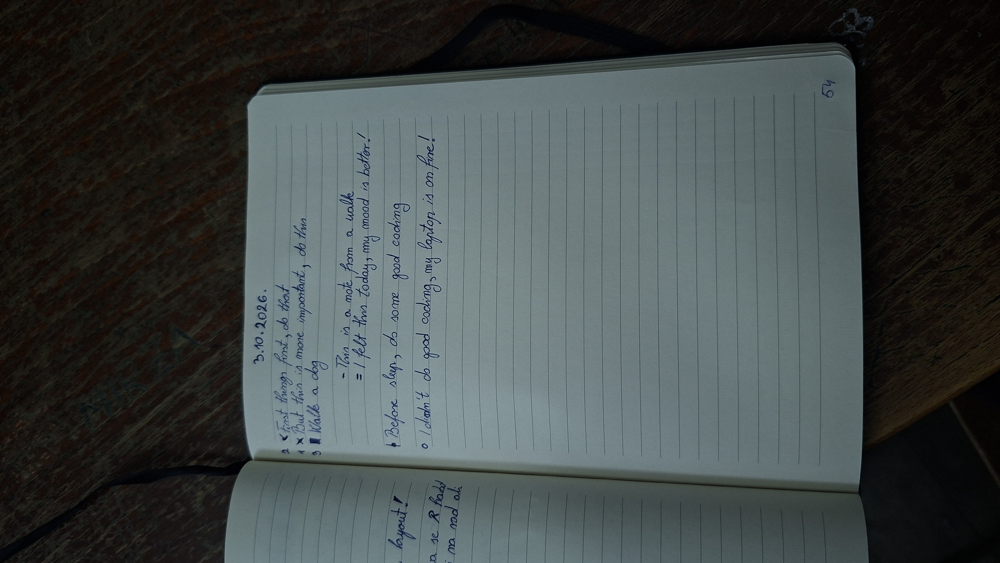

# How a bullet journal made my everyday life more productive

While cutting out distractions and mindless brainrot, I needed something that would hold me to the principles I was building and constantly remind me of them. The motivation, and the discipline that followed, came from a channel called **Bullet Journal** ([starting video](https://youtu.be/fm15cmYU0IM)), which explains the format and approach of a journal that actually has an effect.

The point is that no matter how many To-do or Calendar apps you set up, they simply don't give every person a positive result. They lead to people no longer opening them and/or to stress once the To-do items pile up. I had experience with Notion, which I set up once and never opened again...

Facts that support writing goals and to-do items on paper:

1. **Generation Effect:** psychological research shows that ideas and tasks we generate and write by hand are stored deeper in long-term memory. You remember the tasks on your list even if you never look at the list again.
2. **Fewer distractions:** paper sends no notifications, offers no extra tabs and doesn't split your focus, which allows a deeper level of organizing your thoughts.
3. **Kinesthetic memory:** people who use paper have better spatial orientation within their own obligations. The brain remembers where a task was on the page (e.g. top left corner, next to a drawing), which makes mentally mapping the day easier. Physically crossing out or filling in BuJo symbols (• into X) gives a stronger tactile sense of completion and releases dopamine more intensely than clicking a digital circle.

And many more, such as a higher rate of reaching goals, actions and wishes.

## The effect after one month

The result of bullet journaling went in a perfect direction. I couldn't even fall asleep without putting tomorrow on paper first. Some things I noticed about myself:

- **Stress at a minimum:** I was known as a person who is gloomy at first sight, easily affected, "short-tempered" and everything closely tied to elevated cortisol. Now I'm far more tolerant in everyday life and more pleasant to other people.
- **More focused:** from someone who couldn't sit still in a work session, I now get so absorbed that I don't even know what time it is.
- **More disciplined:** before the journal I made excuses for training and working at home. A little later, every workout is better than the last because I write those down too, and I get regular sleep because I developed respect for how important sleep is.
- **"Combo effect":** the habit tracker (journaling instructions are in the section after this one), besides the results, gives me satisfaction when I see that e.g. training, reading a book and work have been kept up for 5 days in a row.
- **A day planned from morning to dusk:** there is no hour in the day that isn't taken (of course, you leave yourself some slack). Start lightly in the first days, and once you see you can handle everything, just line up more things. The ones that later become a given (getting up at xx:xx, training at xx:xx) stop being written down and other things take their place, so we don't lie to ourselves about the amount of actions in a day.

## The journal format

**Prerequisite:** a pen and a journal or any notebook.

### 1. Intentions

- 1 to 5 intentions you want to fulfil during this process

**Format:** I want to be (something or someone) so that (reason or way)

### 2. Index

**Prerequisite:** number the pages as you go.

- The chapter name and, next to it, the range of pages from which to which that chapter runs

**Example:** Acts (October) 13-43, 45-47, 49

**Note:** if chapters overlap, which is completely natural, just start making ranges again or list the pages.

### 3. Future log

**Format:** give each month a couple of lines and write down things that may eventually happen (events, obligations...).

**Rule:** never write in a month we have already entered (e.g. in October we only write for November, December...).

### 4. Month log + habit tracker

A page where each row belongs to one day (day of the week and day of the month), with up to 3 habits you can do that day lined up vertically.

| Day | Event | Habit 1 | Habit 2 | Habit 3 |
|-----|-------|:-------:|:-------:|:-------:|
| 12 Wed | birthday | x | x | x |
| 13 Thu | | x | x | |
| ... | | | | |
| 31 | | x | | |

This is the section you visit daily, and the habit tracker should give you the satisfaction of the "Combo effect".

### 5. Daily actions (Acts)

The date of the day being written.

**Note:** the best practice is to write down the night before what the day will hold.

- A place for reminders, interesting things, acts, feelings, etc.

**Symbol legend:**

| Symbol | Meaning |
|:------:|---------|
| • | Action (just written) |
| x | Action (done) |
| \| | Action (not done) |
| ▮ | Action (impossible to do) |
| &lt; | Action (postponed) |
| - | Reminder, note |
| = | Feeling, impression |
| ○ | Interrupt (something that distracted us) |
| * | Something important (an addition to any of these symbols) |

**Best practice:** after listing the actions, immediately number the top 3 for a better effect.

**Note:** this is not a to-do but an action, a move. The reason is that a To-do psychologically creates stress and a poor approach to the things we need to do.

